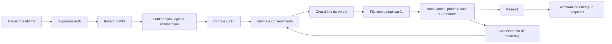

# Fluxo de e-mail da Omega Courses

## Implementação

Confirmação, acesso por link e recuperação usam a autenticação do Supabase. O Resend entrega essas mensagens por SMTP. As campanhas são separadas e exigem consentimento; cancelá-las não cancela o acesso ao curso.

Assuntos, corpos, botões e rodapés usam português brasileiro, inglês ou espanhol conforme `email_locale`. O rodapé identifica a marca com **Ω · © Omega Courses**. Alterar o idioma no perfil atualiza a preferência de e-mail e os metadados do Supabase Auth.

## Estado verificado em 10 de outubro de 2026

O domínio `omega.courses` está verificado no Resend e habilitado para envio. O domínio raiz redireciona para o canônico `www.omega.courses`; os links de autenticação e campanhas usam o canônico e aceitam callbacks nos dois hosts. O remetente é `contato@omega.courses`. Os segmentos de e-mail estão cadastrados. As migrations de preferências, idioma e fila constam no histórico remoto do Supabase; o código inclui fila, limite por usuário, conteúdo estável nas novas tentativas, cancelamento e validação de assinatura dos webhooks.

A integração ainda não está operacional em produção. Na Vercel, `RESEND_API_KEY`, `CRON_SECRET` e `EMAIL_UNSUBSCRIBE_SECRET` existem como variáveis, mas estão sem valor; `SUPABASE_SERVICE_ROLE_KEY`, `RESEND_WEBHOOK_SECRET` e `MARKETING_POSTAL_ADDRESS` não estão configuradas. O acesso conectado ao Supabase não oferece a chave administrativa nem acesso à configuração de SMTP/Auth. As migrations estão no banco, mas os nomes/versões de três arquivos locais divergiam do histórico remoto; foram alinhados para evitar reaplicação.

O marketing permanece desativado até que a chave Resend, a chave de servidor Supabase e o endereço postal real estejam configurados. O domínio está sem webhooks registrados; o endpoint local já existe, mas precisa ser publicado antes do registro. O nome configurado é `Omega Courses`; nenhum endereço foi inventado.

As alterações locais ainda precisam de commit e publicação na Vercel. Nenhum e-mail real foi enviado durante a implementação. As tabelas de operação de marketing são protegidas por RLS e devem permanecer acessíveis somente por chave administrativa do servidor.

## Configuração e validação

`npm run email:configure` verifica o acesso antes de alterar configurações. Com as credenciais no ambiente, `npm run email:configure -- --apply` aplica e verifica SMTP, callbacks, assuntos e templates; também salva as chaves de servidor como variáveis protegidas da Vercel.

Validação local: `npm run test:email`, `npm run test:i18n`, `npm run lint` e `npm run build`. O teste de entrega real deve ser feito somente após a configuração de produção, usando uma conta de teste autorizada.

Veja [autenticação](auth-email.md) e [campanhas de ciclo de vida](email-marketing.md) para os detalhes de configuração.
