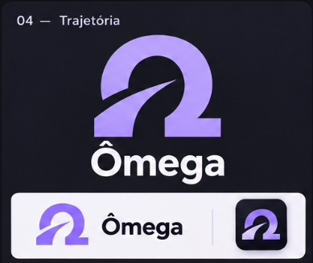

# Prompt de implementação: Ômega, identidade Trajetória

Implemente a repaginação visual deste projeto usando o nome **Ômega** e a direção de logo **04, Trajetória**, aprovada pelo usuário. Trabalhe no site existente e entregue código funcional, assets reutilizáveis e validação visual. Não termine apenas com um plano ou uma apresentação de conceitos.

## Referência e prioridade

A referência aprovada está em `docs/omega/referencia-trajetoria.png`, relativa à raiz do repositório. Abra e observe a imagem antes de desenhar a marca.

O símbolo é um Ω robusto, com uma abertura interna e um corte diagonal ascendente que atravessa sua lateral esquerda em direção ao centro. Esse gesto representa trajetória de aprendizado. Preserve a silhueta, a direção do corte e o equilíbrio da referência. Não substitua por um Ω de fonte, por um foguete, por uma seta genérica ou por um gráfico de cotação.

Nesta etapa, priorize a identidade e a repaginação. A internacionalização fica para uma etapa posterior. Mantenha o português e o acento de **Ômega**, centralize os textos novos e permita expansão de layout para futuras traduções.

Use a skill `design-taste-frontend` disponibilizada no ambiente. Aplique seu protocolo de auditoria e suas regras às páginas públicas. Nas telas de estudo, conta e administração, priorize a legibilidade e a continuidade dos fluxos existentes.

## Contexto real do projeto

O projeto usa React 19, TypeScript, Vite, React Router, Tailwind v4, Outfit Variable e componentes existentes. Já possui `framer-motion`, GSAP, React Three Fiber, Drei e `three-stdlib`. Lucide já é utilizado; mantenha a família de ícones para evitar inconsistências.

Pontos de entrada confirmados:

- `src/components/brand.tsx`: marca compartilhada, hoje com o nome Cripto do Zero e a imagem `/brand-mark.png`.
- `src/components/site-header.tsx`: cabeçalho e rodapé públicos.
- `src/pages/landing-page.tsx` e `src/styles/landing.css`: página de apresentação.
- `src/index.css`: tokens, tipografia e estilos compartilhados.
- `src/components/app-utilities.tsx`: animação de entrada com progresso baseado em tempo.
- `src/components/ui/3d-ascii-model-viewer.tsx`: moeda de Bitcoin renderizada em ASCII.
- `src/contexts/platform-entry-context.tsx`: controle da entrada na plataforma.
- `index.html` e `scripts/prerender-learning.mjs`: verificar marca e metadados na saída publicada.

Confirme os arquivos e suas responsabilidades antes de editar. Não migre o projeto para Next.js, não troque a stack e não instale uma segunda biblioteca de animação para duplicar recursos existentes.

## Auditoria antes das mudanças

Leia as instruções locais e verifique `git status`. Preserve as mudanças de outros trabalhos. Não sobrescreva arquivos inteiros para facilitar a implementação.

Execute o site localmente e registre capturas da landing, login e uma tela de estudo disponível. Observe navegação, contraste, hierarquia, excesso de efeitos, comportamento em celular e funcionamento dos CTAs. Não invente acesso autenticado se não houver uma sessão de teste autorizada.

Declare a leitura de design: repaginação de uma plataforma de educação em cripto, com identidade tecnológica sóbria, marca reconhecível e foco em ajudar a pessoa a entender os cursos e começar a estudar.

Use `DESIGN_VARIANCE: 7`, `MOTION_INTENSITY: 4` e `VISUAL_DENSITY: 4` nas páginas públicas. A assimetria deve organizar o conteúdo; o movimento deve comunicar entrada, feedback ou carregamento. Nas telas de estudo, reduza o movimento.

## Sistema de marca

Produza uma matriz vetorial limpa, fiel à referência, com fundo transparente e `viewBox` consistente. O raster anexado é referência visual, não uma imagem para recortar e colar inteira no cabeçalho. Não inclua a legenda “04”, o painel escuro ou os exemplos de aplicação no asset final.

Desenhar o símbolo proprietário da Ômega em SVG faz parte desta tarefa. Isso não autoriza desenhar manualmente todos os ícones da interface.

Derive da mesma geometria:

1. Símbolo isolado em lilás sólido.
2. Assinatura horizontal com símbolo e nome Ômega para o cabeçalho.
3. Assinatura vertical para uma aplicação de destaque, quando necessária.
4. Versão branca para fundos escuros e versão escura para fundos claros.
5. Versão com gradiente lilás discreto, restrita a aplicações maiores.
6. Ícone quadrado, favicon e ícone de instalação, quando o projeto tiver suporte a instalação.
7. Versão simplificada para tamanhos pequenos, preservando o corte ascendente.

Confira o símbolo em 16, 24, 32 e 48 px. Se o corte desaparecer, ajuste apenas a versão pequena e documente essa adaptação. Não faça seis logos diferentes: são aplicações da mesma marca aprovada.

Crie um componente de símbolo reutilizável e evolua `Brand` com variantes de assinatura, tamanho e tom. Garanta nome acessível no link e evite anúncios duplicados do símbolo e do wordmark. Preserve o destino atual do link da marca.

Guarde os assets finais em `public/brand/omega/` ou no diretório de assets equivalente do projeto. Gere PNGs nos tamanhos necessários a partir da matriz. Inclua uma página ou arquivo de prévia para comparar versões claras, escuras e pequenas.

## Direção visual

Mantenha o lilás porque ele vem da identidade aprovada. Use o acento com disciplina, sem glow espalhado pelo site.

Paleta inicial de marca, ajustável após medir contraste:

| Papel | Cor de referência |
| --- | --- |
| Fundo escuro | `#101016` |
| Superfície escura | `#191922` |
| Texto principal escuro | `#F5F3FA` |
| Texto secundário escuro | `#B7B2C5` |
| Lilás da marca | `#A58BF4` |
| Lilás claro de destaque | `#DCD5F8` |
| Fundo claro | `#F7F7FB` |
| Texto principal claro | `#191922` |
| Acento acessível no claro | `#6742B5` |

Use tokens semânticos compartilhados. Defina o tema na raiz da página e mantenha todas as seções no mesmo tema. Preserve a preferência já existente; se não houver, implemente claro, escuro e sistema com persistência. Teste ambos os temas. Use texto escuro no botão lilás claro, e valide os contrastes dos estados hover, foco e desabilitado.

Mantenha Outfit Variable auto-hospedada. Trabalhe peso, largura de texto e espaçamento antes de adicionar outra fonte. Defina uma escala coerente de raios: controles em 10 px, superfícies em 16 px, círculos apenas quando sua função pedir. Limite o conteúdo a aproximadamente 1280 px, com margens de 20 px no celular e espaçamento baseado em múltiplos de 4.

## Repaginação das páginas

### Landing

Crie um hero assimétrico: mensagem e ação principal à esquerda, aplicação visual da marca à direita. No celular, mensagem e CTA vêm primeiro. A logo do cabeçalho permanece compacta; o símbolo grande é uma aplicação visual, não um segundo cabeçalho.

Use um título concreto sobre o aprendizado oferecido, texto curto e uma ação principal que leve a um fluxo real. Uma ação secundária pode apresentar a trilha, desde que tenha finalidade diferente. Não prometa acesso imediato por pagamento se o checkout não estiver conectado.

Aproveite o conteúdo verdadeiro de cursos e jornadas para comunicar o que se aprende. Use composição editorial para a apresentação e uma grade própria para o catálogo. Evite transformar toda informação em três cards iguais.

Use capturas reais ou componentes reais do produto quando precisar mostrar o curso. Não simule dashboard com retângulos decorativos. Se uma captura não puder ser obtida, escolha uma aplicação honesta da identidade.

Organize a sequência conforme o conteúdo existente: apresentação, trilhas disponíveis, experiência de estudo, evidências reais, planos e dúvidas. Não crie seções vazias só para completar esse roteiro. Preserve títulos e descrições pedagógicas relevantes.

Não invente alunos, depoimentos, empresas clientes, contadores, descontos, escassez ou resultados de aprendizado. Use os valores existentes e preserve avisos sobre funcionalidades ainda indisponíveis.

### Restante da plataforma

Atualize marca, tokens e componentes compartilhados em login, recuperação de acesso, navegação do aluno, rodapé, certificados gerados e metadados onde o nome representa a plataforma.

Preserve nomes de cursos, menções pedagógicas a Bitcoin, conteúdos históricos e marcas de terceiros. “Cripto do Zero” pode continuar como título de curso se esse for seu papel; não faça substituição cega em todos os arquivos.

Não modifique rotas, autenticação, permissões, contratos de API, IDs, chaves de armazenamento, dados de progresso, lógica financeira ou conteúdo legal como efeito colateral da troca de marca. Ajuste o visual das telas operacionais sem aplicar a composição de landing a tabelas ou ferramentas.

## ASCII 3D da Ômega

Adapte a infraestrutura existente para uma aplicação do símbolo Trajetória em ASCII. A silhueta frontal deve permitir reconhecer o corte diagonal, sem virar apenas uma esfera ou uma moeda com Ω impresso.

Use uma extrusão rasa da matriz da marca, inclinação leve e oscilação lenta de aproximadamente 12 graus. Evite uma rotação completa que deixe a marca de costas ou ilegível. Renderize em monocromia lilás, com fundo transparente e densidade de caracteres adequada ao tamanho disponível.

Carregue a cena sob demanda. Não mantenha dois canvases ativos para hero e loader. Não adicione shaders de fundo à cena. Ofereça SVG estático quando WebGL estiver indisponível, em dispositivos com desempenho insuficiente ou com movimento reduzido.

O componente atual de entrada usa duração fixa de 2350 ms e porcentagem calculada pelo relógio. Remova essa espera artificial. O conteúdo deve ficar utilizável assim que estiver pronto; a pessoa não precisa assistir à animação para entrar.

Mostre o loader apenas durante uma espera real e, preferencialmente, após cerca de 200 ms para evitar flashes. Use status indeterminado quando não houver progresso mensurável. Não mostre porcentagem fictícia. Não esconda conteúdo já disponível enquanto o asset decorativo termina de carregar.

Se usar a cena no hero, deixe a versão estática visível primeiro e permita pausar movimento contínuo. Não bloqueie a renderização da mensagem ou dos CTAs pelo carregamento de WebGL.

Para o render ASCII, limite atualizações a cerca de 24 fps, evite `setState` por frame, pause quando a aba estiver oculta ou o componente sair da tela e descarte recursos ao desmontar. Trate erros de renderização com fallback local. O desenho é decorativo; anuncie somente o status real de carregamento com `role="status"`, sem ler cada frame para tecnologias assistivas.

## Evitar aparência de template

- Sem robôs, cérebros, partículas, blobs ou malhas luminosas genéricas.
- Sem texto grande com gradiente, bordas neon e efeito de vidro em todas as superfícies.
- Sem cursor personalizado, scroll bloqueado, palavras embaralhadas ou ticker decorativo infinito.
- Sem números de seção, rótulos técnicos ou selos fictícios como enfeite.
- Sem jargão de marketing como “revolucione”, “desbloqueie seu potencial” e “o futuro começa aqui”.
- Sem travessões ornamentais nos textos novos.
- Sem converter loaders em uma introdução obrigatória.

Use a identidade por meio de geometria, tipografia, espaço e contraste. O corte diagonal pode aparecer em uma aplicação de destaque, mas não deve se repetir como ornamento em todos os componentes.

## Acessibilidade e verificação

Garanta teclado, foco visível, menu móvel funcional, alvos de toque adequados e contraste WCAG AA. Respeite `prefers-reduced-motion`. O conteúdo permanece visível quando animações não executarem. Preserve estados vazios, erros e carregamento dos fluxos existentes.

Teste em larguras de 360, 390, 768, 1280 e 1440 px, incluindo zoom de 200%. Nenhum texto ou logo deve ser cortado. Reserve espaço para mídia e fontes para evitar saltos de layout.

Execute `npm run lint` e `npm run build`. Use testes existentes quando o fluxo alterado exigir. Verifique no navegador navegação pública, login, catálogo e tela de aula quando houver sessão autorizada. Teste WebGL indisponível e movimento reduzido. Meça Lighthouse e reporte números observados, sem declarar metas atingidas por suposição.

Antes de concluir, examine a saída prerenderizada e procure o nome antigo nas superfícies de marca. Classifique cada ocorrência restante para distinguir título de curso de marca desatualizada.

## Entrega

Entregue a repaginação implementada, a matriz SVG e suas variações, a prévia da marca, capturas antes e depois e um guia breve de aplicação. Informe os arquivos alterados, verificações executadas e limitações reais.

Não publique, não altere serviços remotos e não faça migrações de banco como parte deste trabalho visual. Não afirme ganho de conversão ou tráfego sem medição. A conclusão exige que o site funcione e que a marca Trajetória continue reconhecível no cabeçalho, no ícone pequeno e na aplicação ASCII.
